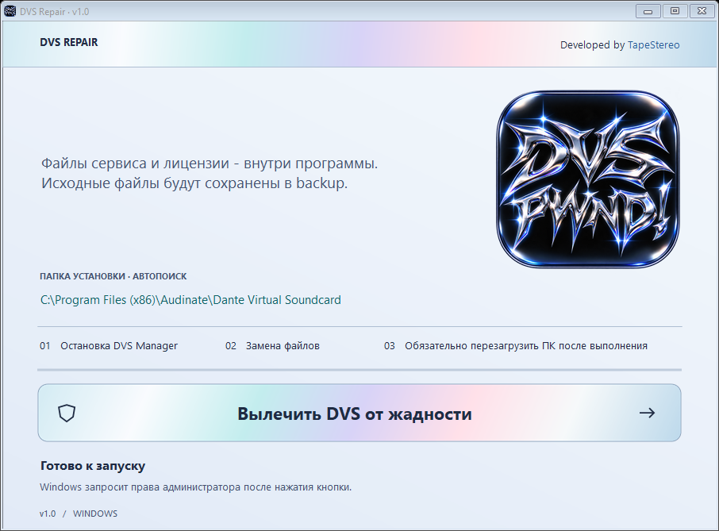

# DVS Repair

Переносимая утилита Windows для резервного копирования и замены файлов Dante Virtual Soundcard.

Developed by [TapeStereo](https://github.com/TapeStereo).



## Скачать

[DVS-Repair-v1.0.exe](https://github.com/TapeStereo/DVS-Repair/releases/download/v1.0/DVS-Repair-v1.0.exe) · [Все файлы релиза](https://github.com/TapeStereo/DVS-Repair/releases/tag/v1.0)

EXE содержит все необходимые для замены файлы; соседние папки и интернет для работы не требуются.

## Использование

1. Установите Dante Virtual Soundcard на Windows 10/11 с .NET Framework 4.8.
2. Запустите `DVS-Repair-v1.0.exe`.
3. Нажмите «Вылечить DVS от жадности» и подтвердите запрос прав администратора.
4. После успешного выполнения обязательно перезагрузите ПК. Программа предложит сделать это сразу.

Папка установки определяется по зарегистрированной службе Dante Virtual Soundcard Manager. Используется только имя `Audinate`.

## Что делает программа

- Проверяет целостность встроенных файлов по размеру и SHA-256.
- Открывает диспетчер задач и останавливает службу DVS через Windows SCM.
- Сохраняет оригиналы в папках `backup` рядом с ними, отдельно для каждого запуска.
- Заменяет `dvs_service.exe` в папке установки и три файла в `%ProgramData%\Audinate\Licensing`.
- Проверяет результат и возвращает службу в исходное состояние.
- При обычной ошибке восстанавливает уже заменённые файлы из резервных копий.
- Предлагает перезагрузку; она начинается только после явного согласия.

Резервные копии:

```text
<папка DVS>\backup\<дата-ID>\dvs_service.exe
%ProgramData%\Audinate\Licensing\backup\<дата-ID>\<файлы лицензии>
```

В обеих папках сохраняется `backup-index.tsv`. Журнал `repair.log` и результат `result.txt` находятся в backup сервиса. Подробности восстановления — в [README.txt](README.txt).

## Сборка

Требуются Windows и компилятор C# из .NET Framework. Дополнительные пакеты не нужны. Для пересборки отдельно подготовьте входные файлы: `payload\dvs_service.exe` и `payload\Licensing` с тремя файлами.

```powershell
powershell -NoProfile -ExecutionPolicy Bypass -File .\build.ps1
```

Результат: `dist\DVS-Repair-v1.0.exe`. Каталог `payload` не публикуется и исключён из Git и архива исходников. Готовый EXE уже содержит встроенные файлы. Логотип находится в `assets`.

Можно передать другой набор файлов:

```powershell
powershell -NoProfile -ExecutionPolicy Bypass -File .\build.ps1 -PayloadRoot C:\путь\к\файлам
```

Ожидаются `dvs_service.exe` и папка `Licensing` с тремя файлами.

## Проверка

Самопроверка работает во временных папках и не изменяет установленную DVS:

```powershell
.\dist\DVS-Repair-v1.0.exe /self-test "$PWD\self-test.txt"
```

Проверены 14 сценариев: извлечение ресурсов, SHA-256, создание резервных копий, сохранение предыдущих копий, ошибка записи backup, блокировка файла и откат после каждого шага замены.

Снимок интерфейса без замены файлов:

```powershell
.\dist\DVS-Repair-v1.0.exe /render "$PWD\preview.png" 1 idle
```

Набор подготовлен для DVS 4.4.1.3. Реальное применение к установленной DVS, совместимость с другими версиями и работа переданных данных лицензирования на другом ПК при подготовке релиза не проверялись.
